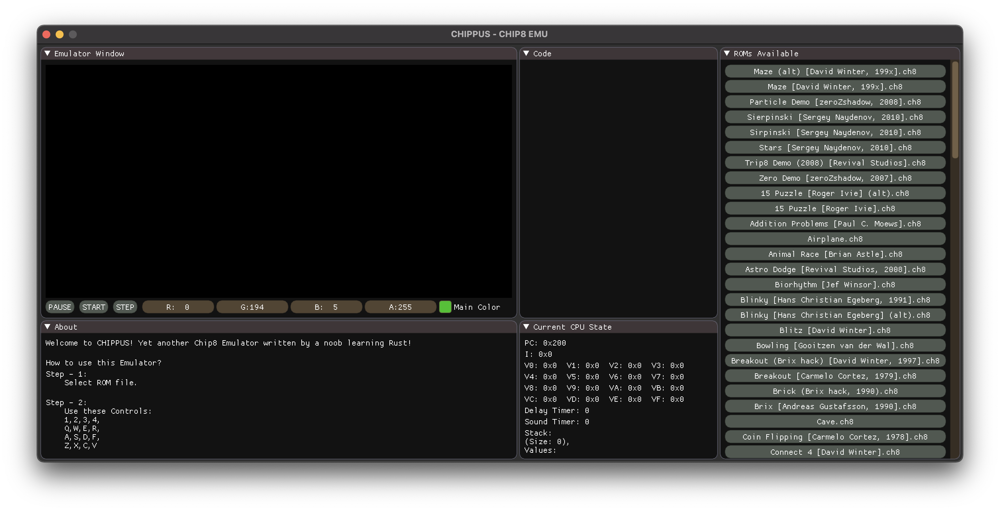
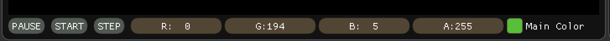

# Chippus

A Chip-8 emulator with a GUI, written in Rust.

[](https://github.com/mosamaasif/Chippus/blob/master/LICENSE)

## About

This is a [Chip-8](https://en.wikipedia.org/wiki/CHIP-8) emulator I wrote as a learning project to get familiar with Rust. It has a full GUI built with Dear ImGui, and comes bundled with a large collection of ROMs (games, demos, hi-res programs). You can pause, step through execution, and change the display color on the fly. It may not be the most optimized implementation, but the focus was on understanding Rust's syntax and ownership model while having fun.

## Demo


## Features

- Full Chip-8 instruction set emulation
- ImGui-based UI with a ROM browser sidebar
- Pause, Start, and Step buttons for debugging execution
- Color picker to change the display tint in real time
- 80+ bundled ROMs (games, demos, hi-res, and utility programs)
- Drop additional `.ch8` ROMs into the `roms/` folder and they appear automatically

## Built With

- [Rust](https://www.rust-lang.org)
- [imgui-rs](https://github.com/imgui-rs/imgui-rs) — Dear ImGui bindings for Rust
- [wgpu](https://wgpu.rs/) — rendering backend (with a vendored imgui-wgpu integration modified for nearest-neighbor filtering)
- [winit](https://github.com/rust-windowing/winit) — window management

## Getting Started

### Prerequisites

- [Rust](https://www.rust-lang.org/tools/install) (2018 edition or later)

### Building & Running

```sh
git clone https://github.com/mosamaasif/Chippus.git
cd Chippus
cargo run
```

Select a ROM from the list on the right side of the window to start running it.



Use the Pause, Start, and Step buttons to control execution, and the color picker to change the display color.



To add more ROMs, place `.ch8` files (compatible with the original Chip-8 spec) in the `roms/` folder and relaunch.

## License

Distributed under the MIT License. See [LICENSE](LICENSE) for details.
